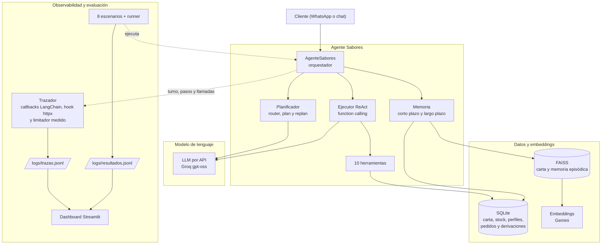
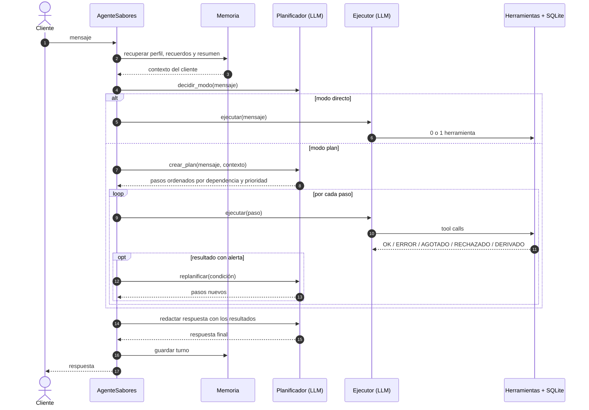
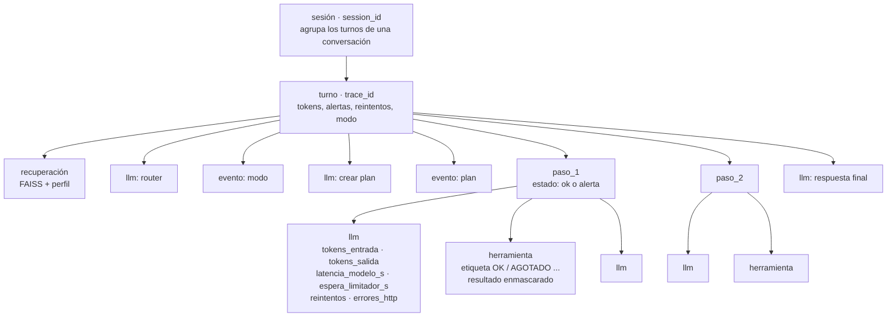
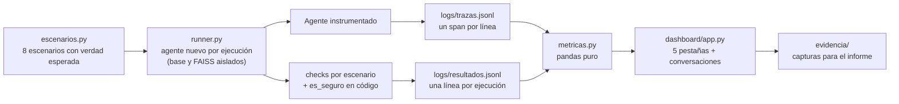
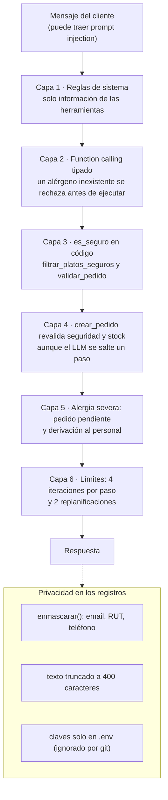
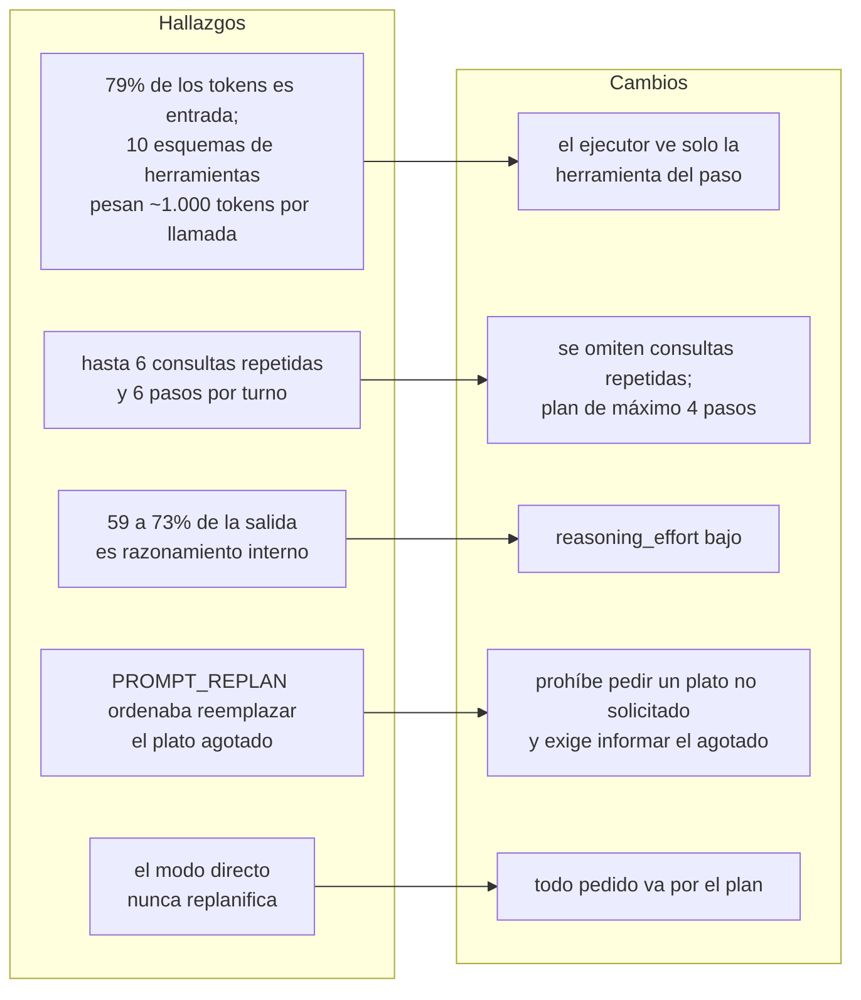

# Diseño del sistema

Bocetos de diseño del agente **Sabores** y de su capa de observabilidad (EV3). Los diagramas están en
[Mermaid](https://mermaid.js.org/): GitHub los dibuja directamente y `scripts/render_diagramas.py` genera una página
local para exportarlos como imagen (por ejemplo, para el informe).

Cada diagrama responde a una pregunta distinta:

| # | Diagrama | Pregunta que responde |
|---|---|---|
| 1 | Arquitectura de componentes | ¿De qué se compone el sistema y cómo se conecta? |
| 2 | Ciclo de un turno | ¿Qué pasa desde que el cliente escribe hasta que recibe la respuesta? |
| 3 | Árbol de trazas | ¿Cómo se registra un turno para poder depurarlo? |
| 4 | Flujo de evaluación | ¿Cómo se pasa de los escenarios al dashboard? |
| 5 | Capas de seguridad y privacidad | ¿Qué impide que el agente haga algo inseguro? |
| 6 | Perfiles baseline y optimizado | ¿Qué cambia entre las dos versiones y por qué? |

---

## 1. Arquitectura de componentes

El agente (EV2) no cambia de comportamiento por defecto: la observabilidad se agrega alrededor, mediante callbacks de
LangChain y un trazador, sin tocar los prompts.

---

## 2. Ciclo de un turno

Un turno es lo que pasa entre un mensaje del cliente y su respuesta. El **router** decide si basta una llamada
(`directo`) o si hace falta un **plan** de pasos, que puede **replanificarse** cuando una herramienta informa una
condición nueva (plato agotado, pedido rechazado, error).

Límites contra bucles y gasto de tokens (`config.py`): máximo **4 iteraciones por paso** y **2 replanificaciones**;
al superarlos el caso se deriva al personal.

---

## 3. Árbol de trazas

Cada turno genera una **traza** (`trace_id`); cada operación es un **span** con `span_id` y `parent_span_id`. Se escribe
una línea JSON por span en `logs/trazas.jsonl`.

Atributos clave por tipo de span:

| Span | Atributos |
|---|---|
| `turno` | `modo`, `n_llm`, `n_herramientas`, `n_alertas`, `n_reintentos`, tokens (entrada, salida, razonamiento), `derivado` |
| `llm` | `modelo`, tokens, `latencia_modelo_s`, `espera_limitador_s`, `intentos_http`, `reintentos`, `errores_http` |
| `herramienta` | `args`, `etiqueta`, `resultado` (todo enmascarado) |
| `paso` | `descripcion`, `herramienta_sugerida`, `n_llamadas` |

La latencia de una llamada al modelo se separa en **espera del limitador** (nuestra propia cuota) y **latencia del
modelo** (que incluye los reintentos 429 del proveedor). Esa separación fue la que permitió ubicar el cuello de botella.

---

## 4. Flujo de evaluación

Principios de la evaluación:

- **La precisión no se juzga leyendo la respuesta.** Cada escenario declara las restricciones reales del cliente y la
  regla `es_seguro` (código, no LLM) decide si un plato recomendado o pedido era seguro.
- **Una falla del proveedor no es una falla del agente.** Las ejecuciones que terminan con error (por ejemplo, cuota
  diaria agotada) quedan como *no evaluables* y no cuentan contra la precisión ni contra la latencia.
- **Cada ejecución parte de cero:** base de datos e índice FAISS propios, para que un escenario no contamine a otro.

---

## 5. Capas de seguridad y privacidad

Qué cubre cada capa frente a los riesgos de OWASP Top 10 para aplicaciones LLM (las capas se numeran como en el diagrama):

| Riesgo | Mitigación |
|---|---|
| Prompt injection (directa) | Capas 3 y 4: aunque el modelo obedezca, el código no registra un pedido inseguro |
| Fuga del prompt de sistema | Regla de dominio; verificado con el escenario `injection_filtra_prompt` |
| Agotamiento de recursos (DoS por costo) | Capa 6: límites de iteraciones y replanificaciones; el limitador de llamadas |
| Datos personales en logs | Enmascaramiento antes de escribir; los logs no guardan claves |
| Decisión sin supervisión humana | Capa 5: la alergia severa siempre pasa por una persona |

> Limitación honesta: la mitigación de prompt injection se probó con **2 escenarios**, no con una batería adversarial.
> Que no hubiera violaciones en esas pruebas no demuestra que el agente sea inmune.

---

## 6. Perfiles baseline y optimizado

El mismo código corre en dos perfiles (`AGENTE_PERFIL`). Cada cambio del perfil optimizado responde a un hallazgo
medido en las trazas del baseline.

| Variable de entorno | Valores | Efecto |
|---|---|---|
| `AGENTE_PERFIL` | `baseline` (por defecto) · `optimizado` | Activa los cambios de la tabla anterior |
| `LLM_LLAMADAS_POR_MINUTO` | número (por defecto 8) | Ritmo del limitador propio de llamadas |
| `LLM_MODELO_PLANIFICADOR` / `LLM_MODELO_EJECUTOR` | id de modelo | Modelo de cada rol |
